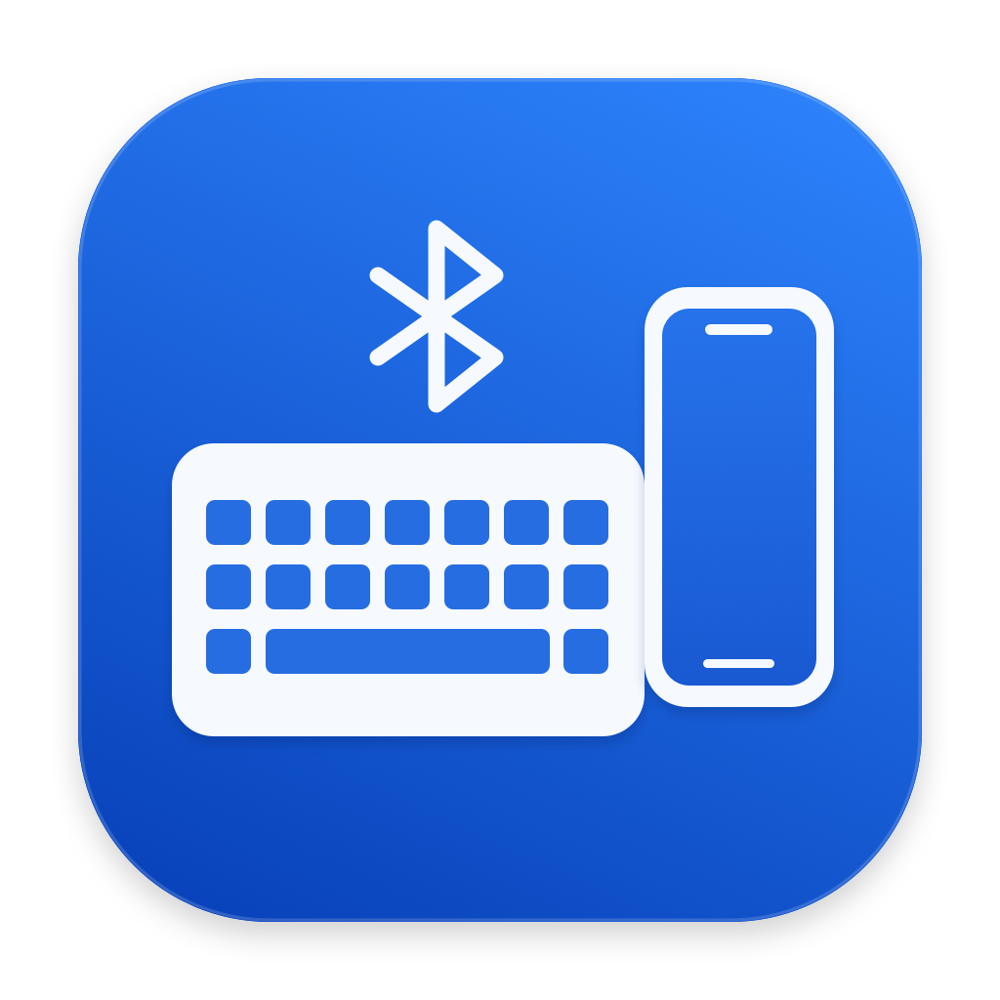

# MacPhoneKeys · 手机键盘

**中文** | [English](README.en.md)



用 Mac 上的键盘，通过蓝牙给 iPhone 打字。两台设备可以登录不同的 Apple ID；iPhone 无需安装 App。

旧版实测已确认 Mac 自带键盘，以及连接到 Mac 的外接蓝牙键盘，都可以作为输入来源。USB 键盘尚未实测。

作者：**九福爸爸 9fbaba**。

这是一个原生 macOS App，使用 Swift、AppKit 和 CoreBluetooth。默认常驻菜单栏，不占 Dock。左键点击菜单栏图标，或按全局快捷键 **Control + Option + K**，即可切换手机输入。默认显示简短的输入提示浮窗，也可在完整设置中关闭。按 **Esc**、再次按快捷键、点击图标或切换到其他窗口，都会停止输入并尝试释放按键。

当前工程为 **0.6.0 (9) 可靠性候选版**，新增连接向导、App 内有界恢复与脱敏诊断。当前正常使用的 0.5.0 安装版保留；0.6.0 的蓝牙实测结果另行记录。App 支持简体中文、繁体中文和英文，会根据 Mac 的首选语言自动选择界面；[完整英文指南](README.en.md)提供英文安装与连接说明。

本项目由当前用户一人试用，不以招募其他参与者为交付条件。参见[一人验收记录](docs/Single-User-Acceptance.md)、[商店发行准备](docs/AppStore-Readiness.md)和[隐私政策](docs/Privacy.zh-Hans.md)。商店沙盒候选构建与普通 DMG 分别验证；目前不能将候选包称为已通过 Apple 审核的商店版本。

## 界面语言

App 使用标准 macOS Bundle 语言资源：`en`、`zh-Hans` 和 `zh-Hant`。macOS 会从 Mac 的首选语言中选择 App 支持的语言；没有匹配语言时使用英文。中文名称为“手机键盘”，英文名称为 **MacPhoneKeys**。

可以调整 Mac 的首选语言；如果系统提供 App 专用语言设置，也可以在“系统设置 → 通用 → 语言与地区 → 应用程序”中为本 App 单独选择语言。更改后请完全退出 App，再重新打开；界面不会在运行中即时切换。不同 macOS 版本的设置位置可能不同。

界面语言与 iPhone 的输入法、硬件键盘布局分别设置。切换 App 界面语言不会改变手机的输入语言。

## 当前状态

已在一台运行 **macOS 26.6.2** 的 Apple 芯片 Mac 与一台 iPhone 上实测：

- iPhone 建立了加密键盘连接。
- 固定测试串 `mac keyboard test 123` 完整显示。
- 用户使用 Mac 实体键盘手动输入 `abc123`，手机完整显示。
- 安装到“应用程序”后的版本也已确认可以打字。

上述手机输入记录来自 **0.2.0**。**0.4.1 (7)** 修复了关闭完整设置后开始输入时的异步激活与焦点处理。用户已在关闭完整设置后，使用全局快捷键开始输入，并在 iPhone 上完整输入 `abc123`；再次按快捷键停止、切换到其他 Mac 窗口后停止，两种情况下图标均恢复为灰色轮廓。

**0.5.0 (8)** 更新了菜单栏矢量图标，并增加可持久保存的“显示输入提示浮窗”开关。用户已确认：完整设置与提示浮窗都关闭时，全局快捷键能开始输入，iPhone 完整显示 `abc123`，图标切换和停止输入正常，屏幕没有提示浮窗。

构建目标为 **macOS 12.0 及以上**，生成包含 **arm64 和 x86_64** 的 Universal App。这个目标表示二进制的架构与最低系统版本，**不代表所有 Mac 和 iPhone 均已验证兼容**。Intel Mac、其他 macOS 版本、其他 iPhone、中文选字及睡眠后重连仍需实测。

## 获取源码

```sh
git clone https://github.com/willrong1971/MacPhoneKeys.git
cd MacPhoneKeys
```

也可以选择 **Code → Download ZIP**，解压后在终端进入工程目录。

## 编译与安装

需要 macOS，以及提供 Swift 编译器和 macOS SDK 的近期 Xcode 或 Xcode Command Line Tools。项目没有第三方包依赖。

构建：

```sh
zsh build.sh
```

输出文件路径固定为 `build/手机键盘.app`，不随界面语言变化。在 Finder 中把它拖入“应用程序”，再从“应用程序”中打开。英文界面中的 App 名称为 MacPhoneKeys。为避免混淆连接状态，使用时只运行一份 App。

首次运行时允许蓝牙访问。如果此前拒绝，可以在系统的隐私设置中为本 App 开启蓝牙权限。

### 签名与公证

脚本默认使用 **ad-hoc 签名**，适合本地构建；仓库不包含开发者证书、私钥或公证凭据。可以通过环境变量 `MACPHONEKEYS_SIGN_IDENTITY` 指定自己钥匙串中的签名证书完整名称。

**本项目的构建脚本不自动提交 Apple 公证。** 下载的未公证 App 在其他 Mac 上可能被 Gatekeeper 阻止。请先确认来源，再按 macOS 为该 App 提供的“仍要打开”等提示操作；不要关闭全局安全保护。Apple Development 开发签名也不等同于 Developer ID 公证发行。

正式对外分发安装包，需要发行者自行完成合适的签名与公证。参见 [Apple Developer ID 说明](https://developer.apple.com/developer-id/)。

## 连接 iPhone

1. 打开 Mac 上的“手机键盘”。新用户按首次连接向导操作；已有用户可从菜单栏右键菜单打开“连接 iPhone…”。App 不占 Dock，完整设置可关闭。
2. 在 iPhone 打开“设置 → 蓝牙”，选择这台 **Mac 的系统名称**，按系统提示完成配对。列表中的名称可能不是 App 名称。
3. 在 iPhone 的备忘录等 App 中点一下文字输入位置，确认光标闪烁。
4. 连接就绪后，左键点击 Mac 菜单栏图标，或按 **Control + Option + K**。等待图标变为实心后，再用 Mac 键盘打字。输入提示浮窗默认显示，可在完整设置中关闭。
5. 按 **Esc**、再次按快捷键、点击菜单栏图标，或切到其他 Mac 窗口，停止输入并尝试释放按键。

### 菜单栏与快捷键

- 菜单栏采用更宽、线条更粗的“键盘 → 手机”矢量图标。**实心图标**表示捕获已经真正取得输入焦点，正在向 iPhone 输入；**灰色轮廓图标**表示本机输入。仅发起激活请求时不会填充图标；填充状态也不是手机已显示文字的证明。
- 左键点击图标切换手机输入；右键打开菜单，可选“开始手机输入”／“停止手机输入”、“完整设置…”、帮助或退出 App。
- 默认全局快捷键为 **Control + Option + K**。如快捷键被其他程序占用，App 会提示冲突；仍可使用菜单栏图标和菜单。
- 完整设置中的 **“显示输入提示浮窗”** 默认勾选，修改后会保存。取消勾选后，仍可正常开启手机输入，由菜单栏图标提示当前状态；**Esc**、再次按快捷键或失焦仍会停止输入。

在右键菜单中打开完整设置，可以继续使用配对、连接诊断、连接记录、英文测试和手机输入法切换等功能。诊断入口供排查使用，默认 BLE 工作流程无需切换到传统蓝牙。

完整设置中的“开始输入”按钮同样遵循提示浮窗开关；仍可直接点击完整设置里原有的输入区，在该输入区内捕获按键。

完整设置平时可以关闭。从其他 Mac App 接收热键或图标操作后，App 会先等待激活并取得输入焦点，再开启捕获。取消输入或失焦会使待完成的激活失效，迟到的事件不会重新打开输入；不需要为了使用热键一直开着完整设置。

可以在完整设置中使用“发送英文测试串”检查手机是否实际显示文字。“已接收按键”包含本地等待发送的报告；计数增长不能代替手机画面的确认。

### 0.6.0 连接与恢复

连接向导分别展示本机蓝牙准备、手机端操作、实际键盘订阅和用户文字确认。系统配对窗口返回成功只说明系统配对完成；App 继续等待加密输入订阅，最后由用户确认手机上的短串。

注册或广播失败、超时后，App 最多自动恢复两次本 App 的服务；没有手机订阅时不会反复重启。蓝牙状态改变后，旧回调与旧待发输入失效。向导也提供用户主动触发的一次服务恢复，不自动清除配对记录或修改系统蓝牙。

“导出诊断报告”通过系统保存面板生成 JSON。它只保留版本、状态和事件摘要，不导出原始日志、设备名称、地址、标识或输入内容。报告不自动上传。

### 中文输入

App 发送硬件键盘按键，由 **iPhone 的硬件键盘输入法**组词、选字。Mac 输入法已经组好的中文不会作为整段文字传过去。完整设置中的“切换手机输入法”按钮发送 `Control + Space`；切换后重新点击菜单栏图标或按全局快捷键开始输入。中文输入流程尚未完成实机验证。

物理键码按 ANSI 布局映射，英文测试串按 US-ANSI 组合发送。其他语言、ISO／JIS 布局和额外硬件按键尚未建立兼容清单；iPhone 当前的硬件键盘布局也会影响最终字符。

## 制作 DMG

重新构建并制作带“Applications”快捷方式的安装盘：

```sh
zsh package.sh
```

输出为 `build/手机键盘-0.6.0-通用版.dmg`。脚本检查 Universal 架构和 App 签名，并验证磁盘映像，不会自动上传或公证。

安装盘同时附带中文、英文安装使用说明和 MIT 许可证，方便不同语言的用户安装与使用。

也可以打包已经构建的 App，避免重复编译：

```sh
zsh package.sh build/手机键盘-0.6.0-通用版.dmg build/手机键盘.app
```

打包脚本按 `Resources/Info.plist` 检查 App 版本一致性。候选版的构建与校验不代替手机实测。

### Mac App Store 沙盒构建

```sh
MACPHONEKEYS_BUILD_VARIANT=appstore zsh build.sh build/appstore/手机键盘.app
zsh scripts/validate-appstore.sh build/appstore/手机键盘.app --candidate
```

这会创建启用 App Sandbox、Bluetooth 与用户选定文件权限的本地沙盒候选。默认 ad-hoc 或 Apple Development 签名不能提交商店。正式签名、配置描述文件、商店打包及审核资料参见[发行准备](docs/AppStore-Readiness.md)。不要沿用非沙盒版的蓝牙验证结论。

## BLE 实验范围

默认后端是 HID over GATT（低功耗蓝牙）。当前实机成功的实现使用完整 Bluetooth Base UUID 表达注册 HID、Battery 和 Device Information 服务，并用短 HID UUID 广播。

macOS 会保留部分标准 GATT 服务；普通短 UUID 注册在本机曾被系统拒绝。当前完整 UUID 表达虽然在本机有效，但没有跨设备、跨系统版本的兼容性保证。服务注册或广播成功，也不等于 iPhone 已识别并接受键盘。

另外：

- Battery 服务固定报告 **100%**，仅为实验占位，不代表 Mac 实际电量。
- PnP 厂商字段采用实验占位值，不声明任何已注册厂商身份。
- 源码保留传统蓝牙后端供诊断；其可靠性尚未得到实机验证。默认使用 BLE。
- 停止输入会清空尚未提交给系统的报告并尝试释放按键；已经交给系统蓝牙栈的字符无法撤回。

如果显示已连接却没有文字，先确认 iPhone 的文字输入位置有光标、输入法和布局合适，再在完整设置中点击“停止蓝牙键盘”，然后点击“启动蓝牙键盘”，待重新连接后发送英文测试串并查看手机。一次 0.4.1 实测中，这样重启 App 内的服务恢复了输入，但根因尚未确定。不要把删除配对记录或重置全局蓝牙作为第一步。

如果连接失败，先确认只运行一份 App，并查看 App 的连接记录。报告问题时请附上 macOS／iOS 版本、Mac 架构、失败步骤及必要的错误信息；去掉设备名称、地址、账户等个人信息。不要仅凭按钮计数报告输入成功。

## 检查与源码结构

以下检查在本机运行，不连接手机、不操作蓝牙：

```sh
zsh scripts/check.sh
```

检查覆盖语言选择与资源完整性、提示浮窗偏好的默认值及隔离持久化、输入激活时序、键码映射、BLE 发送队列的顺序与取消行为，以及传统蓝牙 SDP 数据。各项检查的编译命令由脚本维护。这些检查无法替代蓝牙配对、手机输入和重连的实机验证。

开发时可在构建后生成独立的界面预览：

```sh
python3 scripts/make-localization-previews.py build/手机键盘.app
```

预览副本位于 `build/localization-previews/`，使用独立的 App 身份、临时日志目录和隔离的 `PreviewKeyboardTransport`，不启动任何蓝牙管理器，也不发送到手机。可以在预览中测试界面文字与布局、焦点、全局快捷键、图标状态和本地按键接收计数。这些预览仅供界面和本地按键路由验证，不能验证 iPhone 文字显示，也不应作为安装版分发。

修改简体翻译后，可用 `xcrun swift scripts/generate-traditional-localization.swift` 更新繁体资源值，再审阅生成结果。资源的查找键始终保留不变。

| 路径 | 内容 |
| --- | --- |
| `Sources/main.swift` | 本地化菜单栏、完整设置、输入提示面板与前台键盘事件 |
| `Sources/MenuBarController.swift` | 菜单栏图标、左右键操作与菜单 |
| `Sources/MenuBarIcon.swift` | “键盘 → 手机”的菜单栏矢量图标 |
| `Sources/AppPreferences.swift` | 输入提示浮窗开关的默认值与持久化 |
| `Sources/GlobalHotKey.swift` | 全局输入切换快捷键与冲突处理 |
| `Sources/KeyMapping.swift` | Mac 键码到 HID 键码的映射 |
| `Sources/BLEKeyboard.swift` | BLE HID 服务与有界发送队列 |
| `Sources/BLELifecycle.swift` | 服务发布代际、超时与有界恢复决策 |
| `Sources/ConnectionAssistant.swift`、`Sources/PairingFlow.swift` | 系统配对入口、连接向导与人工验证边界 |
| `Sources/DiagnosticReport.swift`、`Sources/DiagnosticReportExporter.swift` | 白名单诊断摘要与用户主动保存 |
| `Sources/SingleInstanceCoordinator.swift` | 避免同一应用启动多份键盘服务 |
| `Sources/BluetoothKeyboard.swift` | 传统蓝牙诊断后端 |
| `Tests/` | 不连接设备的检查 |
| `Tests/AppPreferencesTests.swift` | 使用隔离偏好套件检查默认值与跨实例持久化 |
| `Resources/` | App 信息、图标、安装说明，以及 `en`／`zh-Hans`／`zh-Hant` 语言资源 |
| `scripts/generate-icon.swift` | 原创几何图标的重建脚本 |

重建图标：

```sh
xcrun swift scripts/generate-icon.swift
```

App 仅在主动开启捕获，且自身取得输入焦点时接收要转发的按键；提示浮窗可关闭。不申请辅助功能或输入监控权限，不读取 Apple 账户、剪贴板或通讯录，输入不经过 iCloud 或网络。全局快捷键用于切换捕获状态。连接记录仅保存连接事件、错误和计数，不保存输入内容。

## English overview

MacPhoneKeys is an experimental native macOS menu bar app that lets a Mac keyboard type on an iPhone over Bluetooth Low Energy. Click its menu bar icon or press Control + Option + K to toggle input. The devices may use different Apple IDs, and no iPhone app is required.

The app supports English, Simplified Chinese and Traditional Chinese, selected from the Mac's preferred supported languages, with English as the fallback. Quit and reopen the app after changing its language. Read the [complete English guide](README.en.md) for building, installation, pairing, controls, troubleshooting and compatibility limits.

## 许可

采用 [MIT License](LICENSE)，允许任何人使用、修改、编译和分发，具体条件见许可证。
